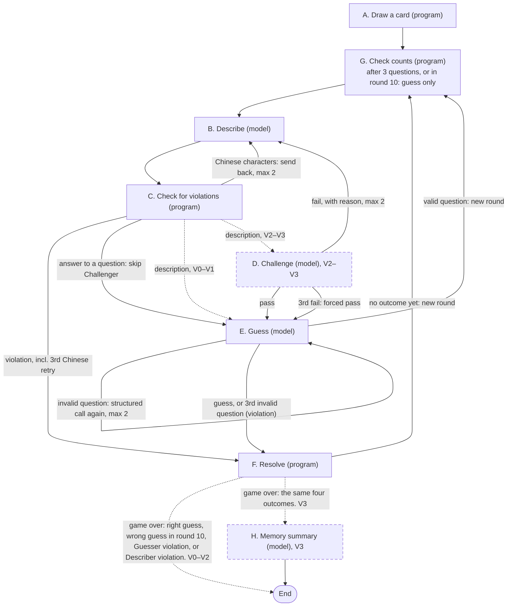

# Don't Say Oyster

## Motivation

- Many Applied AI startups ask for Agentic System Production experience. I really don't have it, so I want to get some understanding and basic experience with Agentic Systems, and that is why I want to build a personal project to really learn how an Agentic System is put together and how it runs.
- Then I saw a job ad from a startup for a role called Founding Engineer, Agentic Systems, and it listed specific skills, and I think this is a basic list that tells me clearly what I should learn.
- After that, I used this list, plus some limits, to decide the project topic:
    - A fun Demo, not solving a real problem, or else the project gets too big to finish; after all, the goal of this project is to add signal to my job search.
    - It will use Ollama and local LLMs.
    - It will use LangChain / LangGraph and some popular SDKs/Frameworks.

## Concept

Before this, I brainstormed with different AIs. In the end I thought of an episode of Friends where they play a drawing game to guess words, and that game idea, plus the earlier brainstorming results, led me to decide the project topic: something close to Taboo. Basically there are two Agents: A and B. A draws a card, and the card has a noun on it; A can't say the noun directly, and can only describe it, such as how many characters it has, or whether it is a food or a movie title, or answer B's questions. Once A says the official name, an accepted alias, or a forbidden word, it counts as a violation and A loses. B, based on A's descriptions, can ask questions or guess which noun it is, but there are at most ten exchanges, and the last one must be a guess. There is also a third Agent C, which challenges whether A's description is precise enough. This game has no time limit (because all three Agents use local models, so inference takes longer). Here I will limit the noun topic, such as only movie titles, or only kitchen tool names, or only dish names, mainly to limit the size of the corpus.

## Goals

- This Demo should be based on an Agentic System and be fun.
- Use Agentic SDKs and frameworks to design, build, observe, and analyze.
- We will run ablation experiments with four variants to test each point below step by step.
    - (V1) Agent decision loop: let the agent decide what to do next by itself, check if it was right after doing it, and fix it if it was wrong.
    - (V1) Tool interface: use a typed schema to limit the tool's input and output, let the agent call the tool to get information that is not in its context, and measure whether the tool helps.
    - (V2) Multi-agent handoffs: several agents split the work and hand off to each other, and each sees different information.
    - (V3) Memory management: separate short-term storage within one game from long-term memory across games, decide what is allowed into cross-game memory, and do some folding of cross-game memory.
- At the same time, the items below must be applied in all four variants.
    - Context assembly: decide that on every model call, each role only gets information inside controlled limits.
    - Evaluation and observability: every step can be traced; run the same fixed dataset again and again, and compare the differences between variants.
    - Comparison under non-determinism: even though the output is different every time, still be able to measure the difference between two variants, and give a credibility value for reference.
    - Program-side validation: validate in the program layer, not through the prompt; see Language rules in Game Rules.
- Build it under limited goals and requirements, and have enough material to write and publish a Substack post.

## Non-goals

- Make it a product-based PoC or MVP.
- Make it a boring, textbook-style Demo.
- Add extra, unneeded features, like a Sandbox, Human-in-the-loop, or an Audit Trail.

## Definition of Done

- The four variants are used for the ablation to test the four points: Agent decision loop, Tool interface, Multi-agent handoffs, and Memory management.
- All four variants apply the four shared items: Context assembly, Evaluation and observability, Comparison under non-determinism, and Program-side validation.
- The experiment for each of the four variants can produce its own detailed report, including the variant type and differences.
- These detailed reports should be complete enough for me to analyze and turn into a post, and point out the interesting parts: for each variant, pick two games and paste their full transcripts into the report (descriptions, rejects and reasons, questions and guesses), and then compare neighboring variants.

## Ablation Design

Context assembly, evaluation and observability, comparison under non-determinism, and program-side validation are the shared base for all variants.

- V0: The Guesser guesses directly from the descriptions the Describer gives. Because there is no corpus, asking questions is the Guesser's only source of information. No tools, no Challenger, no cross-game memory. The program Oracle (violation checks, correct-guess checks, counting) is all there. This is the baseline. Tests: nothing; it is the baseline the other three are compared against.
- V1: V0 + the Guesser can look up the corpus, and decides by itself whether to look up again, guess now, or ask a question. Tests: Agent decision loop, Tool interface.
- V2: V1 + the Challenger; a description must first pass the Challenger before the Guesser can go on. Tests: Multi-agent handoffs.
- V3: V2 + cross-game memory; the Describer and the Guesser can bring experience from earlier games into the next game. Tests: Memory management.

The main build will be the V3 variant, but with three toggles added to turn off nodes one by one so the variant can regress to V2, V1, and V0.

## Game Rules

- **R1** It is a closed world, so the answer is always in the corpus.
- **R2** There are three roles: Describer, Guesser, Challenger, and all are LLM Agents.
- Language rules:
    - **R3** The Describer's descriptions and answers are in English, and cannot use Chinese.
    - **R4** The Challenger's verdict and reason are in English, and cannot use Chinese.
    - **R5** The Guesser's guesses must be in Chinese: a guess is in Chinese when it contains at least one Chinese character. Its questions can only be in English, not Chinese [R17]. A non-Chinese guess counts as wrong and uses a round.
    - **R6** Cross-game summaries can only be in English.
    - **R7** All of the above will be checked by the program.
    - **R8** Exceptions to program-side validation, left to the prompt and not checked by the program: the number of sentences in a description, and whether it repeats.
- **R9** There are forty cards, and each card has an official name and accepted aliases, English names, and forbidden words; these are the Oracle's inputs, and the program uses them to check the Guesser's guess [R20] and the Describer's output [R21].
- **R10** The Describer draws a card (given by the program), then gives a description, and after that, based on the Guesser's response, gives a different description or answers the Guesser's question. The program checks the description or answer for a Describer violation [R21].
- **R11** If the description or answer contains Chinese characters but none of the names in [R21], it is not a violation, and the program sends it back to the Describer to rewrite, without using a round, at most two times for each description or answer asked for; if the third try still contains Chinese characters, the program determines it is a Describer violation and the Describer loses.
- **R12** If there is no violation, but what was given is the Describer's answer to the Guesser's question, the Challenger is skipped; if what was given is a description, the Challenger judges it [R35].
- **R13** If it is reasonable, the Guesser guesses from the description; if not, the Challenger has the Describer describe again, with at most two rejects (a fail verdict that sends the description back); the third fail is a forced pass: the description goes to the Guesser, counted as a forced pass and not as a reject.
- **R14** A description or an answer that reaches the Guesser counts as one round; a rejected description does not.
- **R15** Each game (one card) can have ten rounds. The program does the counting [R25].
- **R16** In these ten rounds, the Guesser can guess or ask a question in the first nine, with a limit: at most three questions per game, and the tenth can only be a guess, not a question.
- **R17** A question cannot contain any Chinese characters, and cannot contain the English names of the current card or its distractors, matched by [R22] (the program looks up the distractors' English names in the corpus); if it does, it is an invalid question, and the program sends it back with a fixed message (questions can only be in English and cannot contain English names) to ask again (the structured call [R47] is repeated with the fixed message; the tool loop is not), without using up a question; it can ask again at most two times, and if the third try still contains a name or Chinese characters, the program determines it is a Guesser violation and the Guesser loses.
- **R18** The Describer can give descriptions based on the official name, accepted aliases, English names, and forbidden words.
- The Challenger judges only from what it can see [R34].
- **R19** If the guess is wrong, the Describer should adjust by itself based on the Guesser's guess and the history of earlier descriptions, and give a different description.

## Corpus and Cards

- The topic is Taiwanese snacks. I picked this topic because I think it is fun, and I also want to use it to show what Taiwanese snacks there are.
- The official names and aliases of the snacks are in Chinese; each has matching English names; forbidden words and attributes are in English.
- I will use an LLM to collect all Taiwanese snacks and then build the corpus, aiming for three hundred kinds; each includes several possible Chinese names, English names (common English translations and romanizations, only for program checks, not accepted answers), and attributes and forbidden words. If there are two or more possible names, the most representative one is picked as the official answer, and the rest become accepted aliases. No name is the official name or an alias of more than one entry, and no alias repeats its own entry's official name; names are compared after normalization [R22], so that a guess of one snack never counts as correct for another [R20]. After that, the program will make forty cards from this corpus.
- I will personally go through every entry in the corpus, and based on the official name, make sure the aliases, English names, and forbidden words are reasonable and well covered, and that the attributes follow the definitions below, before making the forty cards.
- Each card is planned to include the following information: (if no language is given, it is always English)
    - Chinese official name.
    - Accepted Chinese aliases.
    - English names. Used for checking descriptions and questions, not accepted answers.
    - Forbidden words.
    - Attributes.
        - Each field has a closed list of values. Every entry carries every field, with distinct values and no more than the field allows; an optional field may be empty.
        - An item sold in several versions is labeled by its most common version; when two versions are about equally common and the field allows more than one value, both are listed.
        - Dish type (required, one): Meal, Snack, Dessert, Drink.
            - Meal: a dish substantial enough and commonly eaten on its own as a meal, regardless of the time of day; it need not be nutritionally balanced.
            - Snack: any other mainly savory food, side soups and side dishes included.
            - Dessert: any other sweet food, pastries, sweet soups, and shaved ice included.
            - Drink: drunk from a cup or through a straw, sweet or not, with or without add-ins.
        - Main ingredients (required, one to three): Rice, Wheat, Noodles, Starch, Root Vegetables, Soy, Beans and Seeds, Pork, Beef, Poultry, Seafood, Other Meat, Egg, Vegetables, Fruit, Sugar and Sweeteners, Herbs, Tea, Milk.
            - The ingredients a diner would name first.
            - Noodles of any grain are Noodles, not Rice or Wheat; noodles are kneaded, cut, or extruded into strips, so batter scraped from the wok in pieces (ding bian cuo) is Rice.
            - Wheat covers buns, dough, wrappers, and pastry.
            - Starch is tapioca or sweet potato starch forming the body or defining texture of the dish (pearls, translucent wrappers, omelette batter, taro balls), not a thickener or a fried coating; taro, sweet potato, carrot, and daikon radish eaten as themselves are Root Vegetables.
            - Soy covers soybeans, tofu, and soy milk.
            - Beans and Seeds covers red beans, mung beans, peanuts, sesame, almonds, and aiyu seeds.
            - Offal and blood go by their animal (pig's blood is Pork, duck blood is Poultry); Other Meat covers animals without their own value, such as lamb.
            - Vegetables covers pickled and preserved vegetables (dried radish, pickled mustard greens).
            - Fruit covers sugarcane.
            - Sugar and Sweeteners covers brown sugar, maltose, honey, and syrups when the dish is named for that sweetener or tastes mainly of it; sugarcane itself stays Fruit.
            - Tea covers tea leaves only; herbal and other "teas" go by their ingredient.
            - Herbs covers grass jelly, herbal teas, Chinese medicinal herbs, mugwort, cudweed, roselle, and ginger.
        - Cooking method (required, one or two): Deep-Fried, Pan-Fried, Stir-Fried, Grilled, Baked, Smoked, Dried, Steamed, Boiled, Braised, Set, No Cooking.
            - The step that gives the dish its character.
            - Braised covers simmering and stewing in a soy-sauce-based liquid; a little soy sauce as seasoning does not count.
            - Smoked covers smoking over sugar, tea, or wood, whether or not the food was cooked first.
            - Dried covers sun-drying, air-drying, and oven-drying.
            - Boiled covers boiling, poaching, blanching, and simmering or stewing in water, stock, or any other liquid that is not soy-sauce-based.
            - Set means left to set into a curd or jelly.
            - No Cooking means assembled from prepared parts (shaved ice, cut fruit, wraps and sandwiches).
            - A drink the stall boils itself (herbal tea, winter melon tea, soy milk, rice milk) is Boiled; a drink pressed, blended, or assembled from prepared parts (sugarcane juice, papaya milk, boba tea) is No Cooking.
            - A candy made from syrup the maker boils itself, alone or binding or coating nuts or fruit (maltose candy, peanut brittle, nougat, candied haws), is No Cooking.
        - Flavor (required, one to three): Savory, Sweet, Sour, Bitter, Spicy, Fermented.
            - Only tastes a first-time eater would notice.
            - Bitter covers bitter melon, bitter herbal teas, and other plainly bitter foods.
            - Spicy covers chili, pepper, and ginger heat.
            - Fermented covers stinky tofu, century egg, and other foods with a pungent, fermented smell or taste.
        - Physical form (required, one): Dry, Sauced, Soup, Thick Soup, Shaved Ice, Ice Pop, Smooth Drink, Drink with Add-ins, Slush.
            - Dry: solid food served without broth, gravy, or substantial sauce; food with only a dipping sauce on the side is Dry.
            - Sauced: food coated, tossed, or served with a substantial sauce, dressing, or seasoned oil, without being submerged in broth.
            - Soup: pieces, curds, or jelly in a thin broth or syrup, eaten with a spoon.
            - Thick Soup: a broth or sweet soup thickened with starch or flour.
            - Shaved Ice: toppings on shaved or snow ice, eaten with a spoon.
            - Ice Pop: frozen in one piece and eaten as is (on a stick, in a bag, or as a block).
            - Smooth Drink: nothing to chew.
            - Drink with Add-ins: pieces to chew (pearls, jelly, beans).
            - Slush: blended ice, with or without add-ins.
            - The three drink values are used exactly when Dish type is Drink.
        - Occasion (optional, any number): Breakfast, Night Market, Festival, Souvenir. An occasion is listed only when the association is culturally established and specific to the dish, not merely because the dish can be found there.
            - Breakfast: commonly eaten for breakfast, or a staple of breakfast-shop menus.
            - Night Market: a signature night-market stall item.
            - Festival: traditionally associated with a specific festival, holiday, or culturally significant life-cycle ritual, even if the dish is also commonly eaten year-round.
            - Souvenir: sold boxed as a regional gift.
        - The Guesser will use them to search the corpus: they are the search tool's filter fields [R44].
    - Distractors.
        - Up to five Chinese official names picked from the corpus.
        - An LLM picks them from the corpus; I review them.
        - Used by the Challenger as one of its references for judging.

## Oracle

- **R20** The program only uses the Chinese official name and aliases to match the Guesser's guess; if it equals an entry in the list after normalization [R22], it is correct.
- **R21** The program uses the official name, aliases, English names, and forbidden words to check the Describer's descriptions and answers; if any is contained, it counts as a Describer violation and the Describer loses.
- **R22** Matching rules: before matching, both the text and the lists go through the same normalization: Unicode NFKC (full-width to half-width), remove spaces and punctuation, lowercase English letters, Traditional-to-Simplified conversion (both sides, so a guess in either script matches). Contains = substring match after normalization; equals = exactly the same after normalization. No fuzzy matching. Chinese lists use substring matching after the normalization above. English lists are handled separately: Unicode NFKC, lowercase, apostrophes (straight or curly) removed, every other punctuation mark turned into a space, and runs of spaces collapsed to one, on both the text and the list; then match as whole words or phrases, with a word boundary before and after; a list item also matches its plural, the item followed by s or es.
- **R23** In the tenth round the Guesser must guess [R16]; if that guess is wrong or not in Chinese [R5], the Guesser loses. Invalid questions and the Guesser violation they can lead to are in [R17].
- **R24** We will not use the program to judge the quality of the Describer's descriptions; the LLM-based Challenger checks them [R35], with rejects and the forced pass as in [R13].
- The flow of one game is in Architecture, Full flow of one game.
- **R25** The program keeps the counters listed in the State table: rounds, rejects in this round, lookups in this round, questions, and forced passes.

## Agent Roles

- **R26** Every role's output from a model call also carries latency, token count, and the attempt number: 1 for the first call made for that output, one more for each send-back or re-ask of [R11], [R17], or [R40], or each redo under the memory Check rule (Cross-game memory definition); a new description after a reject [R13] starts at 1 again, since rejects have their own counter.

### Describer

- **R27** Can see the card's official name, accepted aliases, English names, and forbidden words.
- **R28** The Describer's Prompt will clearly state: descriptions have a sentence limit, at least three sentences and at most four, and make sure no two descriptions are the same; in other words, the program is not used to check this [R8]. Each new description is adjusted based on: earlier descriptions, the Guesser's earlier guesses or questions, and whether the description was rejected by the Challenger.
- **R29** Needs to answer the Guesser's questions; answers are checked for a Describer violation [R21].
- A description or answer with Chinese characters is sent back to rewrite [R11].
- **R30** When rejected by the Challenger, the prompt for the new description includes the Challenger's reason.
- **R31** Does not use any tools.
- **R32** Output: the description itself or the answer to the Guesser's question [R26].
- **R33** Across rounds, remembers each description and each of the Guesser's guesses, questions and answers.
- (V3) Across games: uses cross-game memory to give more accurate descriptions; see Cross-game memory definition.

### Challenger (only added from V2 on)

- **R34** Can only see the card's official name, accepted aliases, and distractors, plus the description the Describer gives, to judge whether the two fit well enough to pass to the Guesser to guess.
- **R35** The rule for judging it reasonable: the English description can lead to the Chinese official name or an alias, and does not also point to any of the distractors.
- **R36** Does not access the corpus.
- **R37** Has no memory.
- **R38** Does not use any tools.
- **R39** Output: the verdict [R26].
- **R40** The verdict is pass or fail; a fail comes with an English reason, and any reason given with a pass is dropped unchecked. If a fail's reason contains Chinese characters, the Challenger is asked once more for an English reason for that same verdict; if the reason still contains Chinese characters, it is replaced with a fixed message. The verdict from the first call is kept in every case.
- **R41** Does not need to remember anything across rounds or games.

### Guesser

- **R42** Can see: the description or answer the Describer gives (all variants), and the corpus (V1). And cross-game memory (V3).
- **R43** (V1) Uses the search tool for the corpus; it can look up by itself at most five times per round, and on the sixth time the program blocks tool lookups and forces a question or guess directly. One lookup is one search-tool call; when one reply carries several, they count one each in order, and calls beyond the fifth are not run.
- Search tool (V1), the Guesser's only tool:
    - **R44** Input: filled by the Guesser: attribute filters (the fields and values in Corpus and Cards, Attributes) and an optional keyword list; keywords are matched against English names by the English rule of [R22] (the keyword is the item sought, the English name the text searched). An entry passes the filters when, for every field filtered on, it has at least one of the given values; an entry with no value in a field never passes a filter on that field. When keywords are given, an entry must also match at least one keyword in at least one of its English names. A call with no filter and no keyword is treated as a call the schema rejects (Recovery, forks, and replay).
    - **R45** Output: matching entries, each with official name, aliases, English names, and attributes.
    - **R46** Limit: at most ten results; if there are more, the output will say there are more.
- **R47** The structured output for the question or guess is a separate call, and does not happen at the same time as a tool call.
- **R48** Output: a question (limits in [R16] and [R17]), or a noun, meaning the guess itself (language in [R5]), plus a confidence score (0 to 1) [R26].
- **R49** (V1) Each time, based on the description given, the Guesser uses the existing corpus and decides whether to look it up, look up more, or guess directly; the lookup limit is in [R43].
- **R50** Across rounds, remembers each of its guesses and valid questions, and the descriptions the Describer gives, questions and answers.
- (V3) Across games: uses cross-game memory to give more accurate guesses; see Cross-game memory definition.

## Architecture

### State schema

| Field | Type | Who can write | Who can read |
| --- | --- | --- | --- |
| Official name and accepted aliases on the card | String array | Me. | Describer, Challenger. |
| English names on the card | String array | Me. | Describer. |
| Forbidden words on the card | String array | Me. | Describer. |
| Attributes on the card | JSON | Me. | Program. (The Guesser sees attributes only through the search tool, as filters [R44] and in results [R45].) |
| Distractors on the card | String array. | Me (picked by an LLM, reviewed by me). | Challenger. |
| Description based on the card, or answer to the Guesser's question | JSON, including: description or answer, latency, token count, and attempt number. | Program. | Guesser. |
| Description based on the card | JSON, including: description, latency, token count, and attempt number. | Describer. | Challenger. |
| Answer to the Guesser's question | JSON, including: answer, latency, token count, and attempt number. | Describer. | Program. |
| Guess or question based on the description | JSON, including: guess and confidence score, or question. Latency. Token count. And attempt number. | Guesser. | Program, Describer. |
| Earlier descriptions and answers | JSON (this game only) | Program. | Describer, Guesser. |
| Earlier rejected descriptions | JSON (this game only; each with its fail reason) | Program. | Describer. |
| Verdict on the Describer's description | JSON, including the verdict and the reason for a fail, latency, token count, and attempt number. | Challenger. | Program, Describer. |
| Earlier guesses and questions | JSON (this game only; guesses and valid questions, not the invalid questions of [R17]) | Program. | Describer, Guesser. |
| Corpus lookup results | JSON (this game only) | Guesser. | Guesser. |
| Describer cross-game memory | JSON | Program (loads from the memory file at game start, writes back to the file at game end) | Describer. |
| Guesser cross-game memory | JSON | Program (loads from the memory file at game start, writes back to the file at game end) | Guesser. |
| Round counter | Integer (this game only) | Program. | Program, Describer, Guesser. |
| Reject counter | Integer (this round, reset to zero each round) | Program. | Program. |
| Question counter | Integer (this game only) | Program. | Program. Guesser. |
| Forced pass | Integer (this game only) | Program. | Program. |
| Card id | String | Program. | Program. |
| Game result | One of the four F outcomes | Program (F). | Program (H). |
| Lookup counter | Integer (this round) | Program. | Program. |

The program can read every row. The row "Description based on the card, or answer to the Guesser's question" is filled by the program after C passes and, in V2–V3, after D passes or a forced pass.

### Information isolation

- Describer:
    - The official name and accepted aliases, English names, and forbidden words on the card.
    - Earlier descriptions and answers.
    - The Guesser's latest guess or question, and earlier guesses and questions.
    - The Challenger's latest verdict with its reason, and every rejected description of this game with its reason (the Earlier rejected descriptions row).
    - Cross-game memory.
    - Round counter.
- Challenger:
    - The official name and accepted aliases and distractors on the card.
    - The description based on the card.
- Guesser:
    - The description or answer the Describer gives.
    - Corpus lookup results.
    - Earlier descriptions and answers.
    - Earlier guesses and questions.
    - Cross-game memory.
    - Round counter, question counter.

### Cross-game memory definition

- After each game ends, the Describer and the Guesser each write a memory entry based on that game's experience, and the program checks whether it has Chinese characters. It builds up game by game, and what built up from earlier games is added to the Prompt of the new game. Size limit: the latest five entries in full, plus one rolling summary of the older entries.
- Disclosure rule: the program only tells the Guesser and the Describer who won and who lost. No matter who wins or loses, the program does not tell the Guesser the correct answer or accepted aliases.
- Write rule: the Describer's summary can include card information. The Guesser's summary only has strategies for guessing better, and does not include the correct answer, accepted aliases, or English names.
- Check rule: after the H node returns, the program checks each role's new entry and, from game six on, its rolling summary for Chinese characters; the Guesser's entry and rolling summary are also checked for the game's correct answer, accepted aliases, and English names. If any is found, a fixed message is attached to ask that role to redo, at most two times; if it still contains them, that game is not written to memory for that role, and that role's memory file is written out the same as the previous game's.
- Storage: each role has its own JSON memory file, saved by game number. The program reads it into State at game start, and after the H node summarizes at game end, the program writes it back. Except for the first game, each game's command only reads the previous game's file.
- Each batch starts from empty memory.

### Full flow of one game

One game. "Program" nodes are Oracle code; "model" nodes are LLM calls.

| Node | Who | What it does | Transitions | Variants |
| --- | --- | --- | --- | --- |
| A — Draw a card | Program | Draws the card for this game | → G | V0–V3 |
| G — Check counts | Program | Increments the round counter [R14]. Enforces question/round limits: after 3 questions, and always in round 10, the Guesser may only return the guess schema [R16] | → B | V0–V3 |
| B — Describe | Model | Describer gives a description or answers a question. V3: prompt includes cross-game memory | → C | V0–V3 (memory branch V3 only) |
| C — Check for violations | Program | Name-check on the Describer's output [R21]; Chinese-character send-back, max 2 [R11] | Chinese characters but no name → B to rewrite, max 2 [R11]. Violation (incl. 3rd Chinese retry) → F. Answer to a question → E, skipping the Challenger [R12]. Otherwise: → D (V2–V3), → E (V0–V1) | V0–V3; D-branch V2–V3 only |
| D — Challenge | Model | Challenger verdict pass/fail; Chinese reason retried once then fixed message [R40] | Pass → E. Fail → B (with reason). 3rd fail → E (forced pass [R13]) | V2–V3 only |
| E — Guess | Model | Guesser asks or guesses. V0: no corpus, no memory. V1–V3: tool loop (≤5 lookups [R43]) then structured output [R47]. V3: with cross-game memory | Question passes name/Chinese check → G (new round). Invalid question → E structured call again, max 2; 3rd → violation → F [R17]. Guess → F | V0–V3; tool loop V1–V3; memory V3 |
| F — Resolve | Program | Determines the outcome | Guess right → Guesser wins. Wrong guess in round 10 → Guesser loses. Guesser violation → Guesser loses. Describer violation → Guesser wins. These four: end (V0–V2) / → H (V3). Everything else → G (new round) | V0–V3; →H branch V3 only |
| H — Memory summary | Model | Describer (full transcript + result) and Guesser (its own transcript + result) each make one call that returns its new memory entry and, from game six on, the updated rolling summary of the older entries. The program checks both (see check rule) and writes the memory files. End | → end | V3 only |

The same flow as a diagram. Dashed arrows and dashed nodes exist only in the variants written on them; arrows leaving a dashed node exist only where that node does. Solid arrows exist in every variant. "max 2" means two retries are allowed and the third failure takes the other path. Who wins on each outcome is in the F row of the table.

Transitions that differ between variants, explicitly:
- C → D exists only in V2–V3; in V0–V1, C → E directly (no Challenger).
- F → H (the four game-ending outcomes) exists only in V3; in V0–V2 those outcomes end the game.
- B "with cross-game memory" and E "with cross-game memory" apply only in V3.
- E "tool loop then structured output" applies in V1–V3; V0's E cannot look up the corpus.

### Recovery, forks, and replay

No LangGraph checkpoints are used; recovery works from files.

- Crash recovery: continue from the last memory file written; the game that crashed is rerun, and it does not resume inside a game. For V0–V2, which have no memory file, the batch script skips cards that already have a JSONL record.
- Model errors: a connection error or a reply the program cannot parse is not retried; the game stops with an error, writes no JSONL record, and is rerun as a crash. A search-tool call whose arguments the tool's schema rejects is not an error: it counts as one lookup [R43] and returns the validation message to the Guesser as its result.
- Fork and rerun: not needed, because the same command only needs a different variant as its argument.
- Replay: decided not to do it.

### Self-checks

- Make sure the flow runs correctly.
- Make sure the flow can be reused.
- Make sure the flow can rerun from the game that did not finish last time.
- Make sure the information the three Agents get is clean enough.

## Evaluation

### Experiment plan

- Comparison method:
    - Why not totals: the hit rate over forty games has an error of about ±8 percentage points by itself, so if two variants differ by three or four correct guesses, we cannot tell whether it is the variant or luck. So we do not compare totals; we compare card by card in pairs.
    - Per-card pairing: for each pair of neighboring variants (V0→V1, V1→V2, V2→V3), we only look at the cards where the two variants got different results. If the new variant guessed right and the old one did not, the new variant wins; the other way around, the old variant wins. Cards where both are right or both are wrong do not count.
    - Credibility: if the two variants are really equally good, who wins each discordant card is like a coin flip, half and half. We use the binomial distribution (one-sided) to get "the chance that a coin would lean at least this far", and credibility = 1 minus this chance. Higher means more credible, and the threshold is the usual 0.95.
    - Why credibility is only for reference: with forty cards there are usually only eight to twelve discordant cards, and reaching 0.95 needs something as one-sided as 8 to 1 (6 to 3 is about 0.75). A gap big enough to cross the threshold needs about one hundred twenty cards, but this project stays at forty.
    - How we read the result: the focus is on "who wins more". The number of discordant cards between two runs of V2 itself (see Optional below) is the ruler for "how many cards pure luck can flip"; only when the winning margin is bigger than that ruler do we say the variant deserves the credit.
    - If there is no second V2 run: we only list who wins and its credibility, do no luck comparison, and do not conclude that the improvement comes from the variant.
- Each game (each card) can run at most ten rounds. Running V0 → V3 once each gives at most 160 games.
- About hit rate: the numerator only counts games where the Guesser really guessed right (the denominator is forty). The number of games with Describer or Guesser violations is a separate metric.
- Confidence score check: compare the confidence score of each guess with its result, to see if high confidence truly means a high hit rate (calibration). One chart for each of the four variants, side by side.
- Extra metrics by variant:
    - V0: out-of-corpus answer rate (including non-Chinese guesses), since without the corpus the Guesser has to come up with the Chinese name by itself.
    - V1: number of lookups per round, and whether the lookup results contain the answer (recall); with the hit rate, this splits into three cases: not found, found but picked wrong, found and picked right.
    - V2: number of Challenger rejects, hit rate of games that had a reject, hit rate of games with no reject.
    - V3: lay out the per-card paired difference between V2↔V3 (correct guess, number of rounds) in game order; if memory helps, the paired difference in later games should lean toward V3. The V2 side already absorbs how hard each card is, so there is no need to split into first and second halves.
- Optional: if there is time, run V2 again; the gap between the two V2 runs is the noise estimate, used to judge whether the gap between variants is bigger than the noise.

### Metrics

- Per game
    - Number of rounds.
    - Win or loss.
    - Whether the guess is the official answer or an alias.
    - Whether the Describer had a violation.
    - Whether the Guesser had a violation.
    - Number of questions.
    - Number of rejects (from V2), summed from the game's JSONL record [R13]
    - Number of forced passes (from V2) [R13].
    - Token count of the memory part (V3).
- Guesses given
    - Attempt number.
    - Confidence score.
    - Latency: the end-to-end delay from sending the prompt to getting the full response, not the model's Thinking mode. It includes thinking time when thinking is on.
    - Token count.

## Implementation

- **Language and runtime**: plan to use Python 3.13 or later. Package management and virtual environments will use uv.
- **Models**: Gemma 4:26B (Guesser), Qwen 3.8:27B (Describer), and Gemma 4:12B (Challenger), all three local models; on a Mac mini M4 Pro + 64 GB, with Ollama serving all three; M2 found that the three do not reliably stay resident together (Q19 in docs/tasks/M2-one-game.md: it depends on load order and on free memory at that moment), so the Describer and the Guesser stay resident and the Challenger is loaded for each call and unloaded after it (keep_alive 0 on its requests), and every call sets its role's keep_alive explicitly rather than relying on Ollama's default; tests in M5 will settle the three models. As for num_ctx, the current defaults are: Guesser 16K, Describer 8K, Challenger 4K. When a role's Prompt tokens on a call start to go over 90% of num_ctx, the program will log a warning. In M4 and M6 the log will be checked and adjusted as needed.
- **Temperature policy**: Temperature is set to 0.7 for now (same value for all three roles, same value for all four variants). We pick >0 because we need variation in the output. In M5 the temperature may change depending on what we see.
- **Batch time estimate**:
    | Role | Calls per round V0 / V1 / V2–V3 | Each call, thinking off | Each call, thinking on |
    | --- | --- | --- | --- |
    | Describer (27B)| 1 / 1 / 1–3 | 15–40 sec | 60–180 sec |
    | Challenger (12B)| 0 / 0 / 1–3 | 8–20 sec | off |
    | Guesser (26B)| 1 / 1–6 / 1–6 | 15–40 sec | 60–180 sec |

    - Assumptions: a 27B-class Q4 model on the M4 Pro, decode about 10–15 tok/s, prefill about 150–300 tok/s; a typical game has 5–6 rounds.
    - Time per call = the decode time in the table above, plus prefill: add 20–80 seconds when the Guesser's later prompts are 6–12K tokens, and add 10–30 seconds for the Describer.
    - Two anchor points (with prefill): with thinking off for all three roles, four batches, 160 games in all take about 25–60 hours (1–2.5 days); with it on for both the Describer and the Guesser, about 95–250 hours (4–10 days).
    - Also add: two calls per game for node H in V3 (see Full flow of one game); the optional V2 rerun adds one more batch.
    - Whether the Describer and the Guesser each have thinking on or off will be decided in M5, and after that the real time will be worked out from the table above.
- **Frameworks and versions**: will definitely use these: LangChain, LangGraph, Phoenix, each at its latest stable version.
- **Data and persistence**: cards and the corpus are stored as JSON. The corpus file's format is `data/corpus/schema.json`, and the loader validates the corpus against it. Within a game, LangGraph State is passed between nodes. Cross-game memory uses JSON memory files.
- **Repo**: the name is "Dont-Say-Oyster"; the directory structure was decided in M1, and the committed directories are its record.
- **Commands**:
    - The parameters for the command that runs one game include: the model and num_ctx for each of the three roles, where the forty cards are, which card to run, where the corpus is, where to write experiment results, the variant, temperature, thinking on/off, and where the memory file is (V3).
    - The command that runs a whole batch of experiments just runs forty commands; it is just a script.
- **Experiment result format**:
    - One JSONL record per game, which also contains for each round the description/answer, question/guess, full Challenger verdict text, corpus lookup and results (from V1). The memory summary at game end (V3).
    - Four batch manifests (models, variant, card set, card order, num_ctx, temperature, thinking on/off).
    - In M1 the order of the forty cards will be decided and written into the manifest, and all four variants share the same order.

## Milestones

### M1 Corpus

- Create the repository "Dont-Say-Oyster" and decide the directory structure.
- Initialize Python environment.
- Decide the schema, including which attribute fields there are, and build the corpus using LLM; each entry includes the Chinese official name and accepted aliases, English names, attributes, and forbidden words.
- I review every entry before the program reads the corpus and selects cards.
- Decide the card-selection and ordering criterion and have the corresponding program.
- The program builds the cards, and writes the order into the batch manifests.
- Decide what the LLM prompt asks for when picking distractors, have the LLM pick up to five distractors per card from the corpus, and review every pick.
- Done when the corpus and the forty cards load into the program without error, every entry and every distractor has been reviewed by me, and the four batch manifests carry the same card order.

### M2 Build the code needed to run one game, based on the V2 spec

- Start with the three models named in Implementation, access models through Ollama.
- Also check whether `OLLAMA_MAX_LOADED_MODELS=3` keeps three models in memory at once. Checked: it is necessary (with 2 the Challenger's load would evict a resident model) but not sufficient (Q19); the arrangement in Implementation (Models) follows.
- Use LangChain + LangGraph to build the basic shape: nodes A–G for V2 (including the Guesser's search tool and tool loop [R43]–[R47]), the four retry loops [R11], [R13], [R17], [R40], and the Oracle checks [R5], [R11], [R16]–[R17], [R20]–[R23], [R43].
- Build the one-game command with the parameters listed in Implementation.
- Check that structured output works for all three models on Ollama, and also check that tool calling works for the Guesser's model and that the separate structured output call [R47] works on Ollama.
- Done when one V2 game reaches F.

### M3 Add observability

- Instrument the program with Phoenix, and see the trace of several rounds in one game.
- Each model call, corpus lookup, and program node shows as a span; model spans carry latency, token count, and attempt number.
- Done when one game's trace in Phoenix shows a span for every model call, corpus lookup, and program node, and the model spans carry latency, token count, and attempt number.

### M4 Get one game running end to end

- Add the variant argument and the Challenger and corpus-lookup toggles so V0 and V1 can run.
- Build the per-game JSONL record with the fields listed in Implementation.
- Test, fix, and fine-tune until one game runs smoothly for each of V0, V1, and V2.
- Check the num_ctx warning log and adjust num_ctx if needed.
- Done when each of V0, V1, and V2 finishes one game at node F with a complete JSONL record.

### M5 Decide models and confirm temperature

- Run one V1 game and personally check how the Describer and the Guesser interact, and decide whether to change models (one or both).
- Run V2 games until ten fail verdicts have accumulated (rejects and forced passes), check them, analyze whether these ten fails are reasonable, and based on that decide whether to change the Challenger model.
- At the same time, check whether the output can be parsed, and whether descriptions repeat or get worse, to adjust the temperature as needed.
- Decide whether the Describer and the Guesser each have thinking on or off.
- If the models, temperature, or thinking on/off change, M5 is rerun until all of them are settled.
- If a model changes, the M2 checks for that model are rerun as well.
- Done when the three models, the temperature, and thinking on/off are written into the batch manifests, and a full M5 pass has run without changing any of them.

### M6 Build the cross-game memory needed for V3

- Add the memory toggle and the V3-only F → H branch.
- Build node H: the Describer and the Guesser each make one call that returns a memory entry and, from game six on, the updated rolling summary; the prompts follow the Disclosure and Write rules.
- Build the check rule: Chinese-character check on both roles' output, answer, alias, and English-name check on the Guesser's, up to two redos, and on failure copy the previous game's file.
- Build the memory files: one JSON file per role, numbered by game, read into State at game start and written back after H; keep the last five entries plus one rolling summary; each batch starts empty.
- Add the memory summary to the JSONL record.
- Check the num_ctx warning log for V3 and adjust num_ctx if needed.
- Done when a V3 game reads the previous game's memory files, the memory appears in the Describer's and Guesser's prompts, and new files are written at game end.

### M7 Build batches and metrics

- Build the batch script: it reads a manifest and runs the forty cards in the fixed order; on a crash it skips cards that already have a JSONL record (V0–V2) or continues from the last memory file (V3).
- Run the four batches on the fixed card set.
- Optional, if time allows: run V2 a second time as the luck ruler mentioned in Evaluation.
- Compute the per-game and per-batch metrics listed in Evaluation.
- Draw the calibration chart for each variant and the V2↔V3 per-card difference laid out by game order.
- Done when four batches have a JSONL record for every card run from the manifest and the metrics and charts are produced from them.

### M8 Analyze and write the report

- For each variant, write the report the Definition of Done asks for: variant type, differences, and two full transcripts.
- Compare each neighboring pair (V0→V1, V1→V2, V2→V3) with the method in Evaluation: who wins, its credibility, and the reading against the second V2 run if there is one. For V3, also paste memory entries from a few games into its report.
- Done when each variant has a report with its type, differences, and two full transcripts, the three pair comparisons are written, and the V3 report includes memory entries from a few games.

## Glossary

Terms whose meaning in this spec is narrower than everyday use.

| Term | Meaning |
| --- | --- |
| Oracle | The program referee; the rules say "program" |
| official name | In Chinese |
| accepted alias | In Chinese |
| English name | Only for program checks, not an answer; in English |
| forbidden words | In English |
| attributes | In English |
| distractors | Standard term in test design; in Chinese |
| round | One turn within a game |
| game | One card is one game; not "match", to avoid confusion with string matching |
| batch | One batch is one variant running all forty games |
| reject | The Challenger rejects a description |
| forced pass | The third fail verdict in a round: the description goes to the Guesser; not a reject [R13] |
| send back | The program sends it back because of a language or name check |
| verdict | The Challenger's output: pass / fail |
| name check | String check on questions and descriptions, including the Chinese character check |
| Chinese characters | Not "CJK", to avoid counting Japanese and Korean |
| discordant cards | Standard term in statistics |
| credibility | Avoids "confidence", because confidence score already uses it |
| latency | End-to-end delay; not "thinking time", to avoid confusion with thinking mode |
| ablation | Means the method: turn off one capability at a time and compare the differences |
| toggle | Only the three capability toggles of V0–V3; for thinking, use thinking on/off |
| fixed message | The sentence attached when the program sends something back |
| tool loop | First half of node E |
| search tool / corpus lookup | The Guesser's only tool |
| thinking on/off | Not "toggle", to avoid confusion with the three variant toggles |
